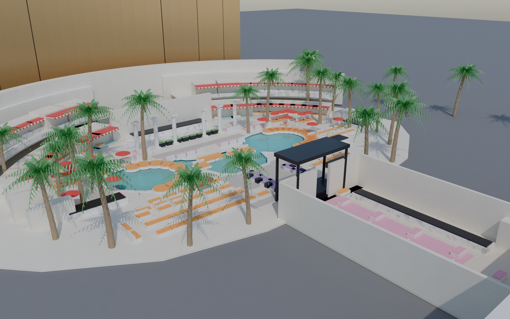
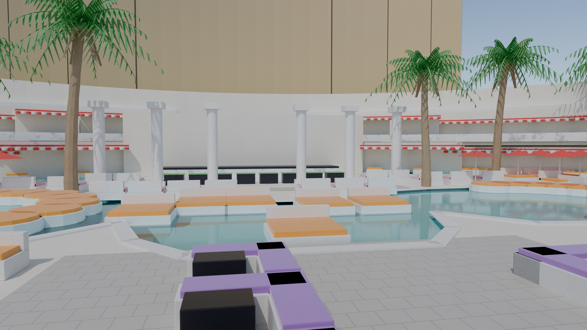
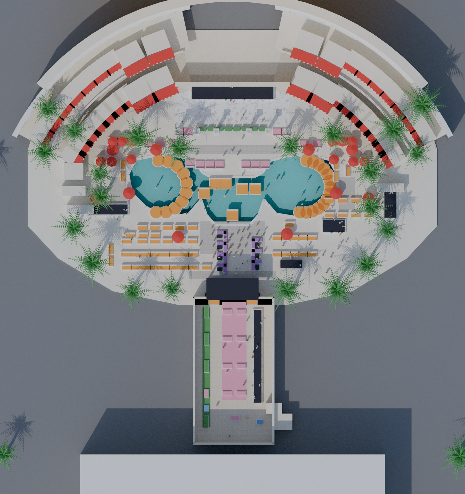
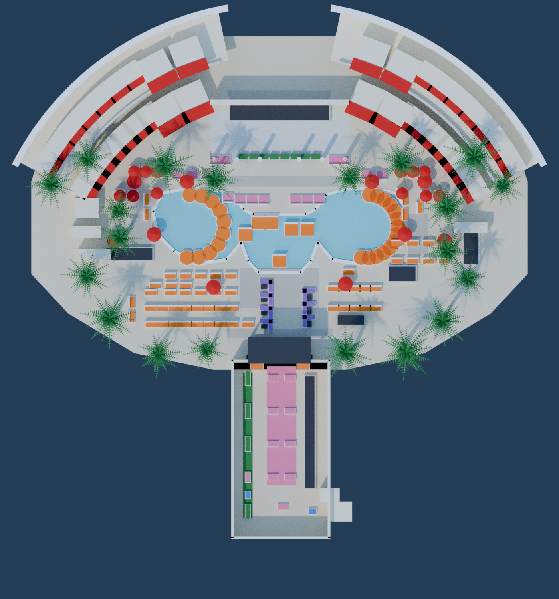

# Encore Beach Club, stylized 3D venue map

A low-poly, web-ready recreation of Encore Beach Club (Wynn Las Vegas), built entirely from a
Python script in Blender and exported as a Draco-compressed GLB. Prototype only: the goal is a
recognizable layout with every bookable table in the right place, not photorealism.

Two looks are built from the same layout data:

- **Stylized** (`--look stylized`, default): one palette atlas, tiny Draco GLB for the web viewer.
- **Photo** (`--look photo`): procedural Cycles materials (travertine tiles, stucco, marble, wicker,
  fabric, bark, refractive water), sun and sky lighting, bevelled furniture, balustrades, column
  capitals, awning scallops, and a backdrop (bronze-glass Encore tower, casino low-rise, ground).
  No textures are downloaded; everything is generated in Blender node trees.






## Files

| File | Purpose |
| --- | --- |
| `build_encore.py` | Builds the whole scene from scratch (bpy), saves the .blend, exports GLBs, renders previews |
| `encore-beach-club.blend` | Saved Blender scene, stylized look |
| `encore-beach-club-photo.blend` | Saved Blender scene, photo look (open and render with Cycles) |
| `encore-beach-club.glb` | Web asset: Draco mesh compression, WebP palette texture, custom properties as extras |
| `encore-beach-club-photo.glb` | Web asset with the photo look: baked colour, normal and roughness textures per mesh |
| `bake/` | The baked PNG textures (also packed inside the photo GLB and .blend) |
| `index.html` + `vendor/` | Three.js viewer: orbit, click-to-highlight, find-by-number, roof toggle, look switch (photo / stylized), image-based lighting and shadows |
| `renders/` | Stage 1 blockout and stage 2 full renders, side-by-side comparisons with the plan, viewer screenshot, uncompressed GLB for size comparison |
| `refs/` | Floor plan reference, Wynn property map, `SOURCES.md`, `layout-notes.md` (pixel-to-metre calibration and the table list) |
| `palette.png` | The 64 x 64 colour atlas used by the single `Atlas` material |

## Size numbers

| Stage | Output | Size |
| --- | --- | --- |
| 1 blockout | `renders/encore-blockout.glb` (Draco) | 63 KB |
| 2 full | `renders/encore-beach-club-uncompressed.glb` (no Draco) | 265 KB |
| 2 full | **`encore-beach-club.glb` (Draco + WebP), the deliverable** | **96 KB** |
| 2 full | `encore-beach-club.blend` | 154 KB |
| photo | `encore-beach-club-photo.blend` (procedural materials) | ~360 KB |
| photo, baked | `encore-beach-club-photo.glb` (baked PNG textures, no Draco) | see below |

Budget was 10 MB (stretch 5 MB, mobile first-load 8 MB). The final GLB is about 1% of the budget.
The viewer page itself is dominated by the vendored Three.js build (about 2.2 MB, cacheable), not
by the model.

Scene statistics (stage 2): 247 objects, 185 table objects, 47 unique meshes, 14.6k triangles
(budget 150k). Two materials in total: `Atlas` (one 64 px palette texture, flat colours) and
`Water` (alpha blended).

## Conventions in the GLB

- Metres. In Blender: +Y points from the DJ booth toward the pools, +Z up, origin at the DJ booth
  centre, South = -X, North = +X. The glTF export is Y-up, so Blender +Y becomes glTF -Z.
- Each table is a node named `T_<number>` (`T_401`, `T_205`, `T_G3`, ...) with extras
  `type`, `number` and `zone`. Table types: `lower_cabana`, `upper_cabana`, `bungalow`, `daybed`,
  `casa_playa`, `lily_pad`, `water_couch`, `beach_couch`, `l_couch`, `stage_couch`,
  `dance_couch_large`, `dance_couch_medium`, `dance_couch_small`, `gaming_table`.
- Zones are Blender collections: Pools, Cabanas_Lower, Cabanas_Upper, Bungalows, Gaming, Stage,
  Backstage, Bars, Walkways, plus Daybeds, Beach_Couches, Dance_Floor, Landscape, Lighting, Cameras.
- Each furniture type is one mesh shared by linked duplicates, so the GLB has one mesh per type.
- Roof nodes (`Gaming_Roof`, `Backstage_Roof`) are separate so a viewer can hide them.

## Running

Rebuild everything (about 2 minutes on 4 CPU cores for the stylized look, most of it the two
Cycles renders; the photo look at 64 samples takes about 45 minutes for its three renders):

```
blender -b --python build_encore.py -- --stage full                 # stylized + GLB
blender -b --python build_encore.py -- --stage full --look photo --samples 64
blender -b --python build_encore.py -- --look photo --bake --no-render      # textured GLB (~20 min)
blender -b --python build_encore.py -- --look photo --cameras eyelevel --samples 16   # quick check
# or, with the pip wheel (python 3.11):  pip install bpy
python build_encore.py -- --stage full [--samples 48] [--no-render] [--out DIR]
python build_encore.py -- --stage blockout     # stage 1 zone boxes only
```

The script runs on Blender 4.0 (Ubuntu apt package) and on the Blender 5.0 `bpy` wheel. Ubuntu's
Blender is built without OpenImageDenoise, so on that build the script disables denoising and
doubles the sample count instead.

Viewer (must be served over HTTP because the page fetches the GLB and Draco decoder). It loads
the photo GLB by default and falls back to the stylized one; `?look=stylized` picks it directly.

```
python -m http.server 8000     # then open http://localhost:8000/index.html
```

## Photo look notes

- `--bake` unwraps every unique mesh (Smart UV Project), bakes base colour, tangent-space normal
  and roughness from the procedural materials into PNGs (512 px for furniture, up to 4096 px for
  the deck and tower), swaps in image-based materials and exports `encore-beach-club-photo.glb`.
  Instances share their prototype's textures, so each furniture type is baked once.
- Ubuntu's Blender build has no Draco encoder, so the photo GLB is uncompressed; running it
  through `gltf-transform draco` or re-exporting from the `bpy` wheel would shrink geometry.
- Water uses a refractive Principled surface that is transparent to shadow rays (Light Path
  node), so sunlight reaches the turquoise plaster basin without refractive caustics.
- The Encore tower, casino block and surrounding ground are rough placeholders for context only;
  their size and position are not measured.

## Known inaccuracies

- **Scale is a guess.** The floor plan has no scale bar. 0.13 m per plan pixel was chosen so the
  outdoor footprint is roughly 5,500 m2 (about 98 m x 60 m). Every dimension inherits this.
- **Heights are estimates**: cabanas 3.2 m, upper level at 3.9 m, facade 8.5 m, pavilion 7 m,
  stage 1.2 m, pool depth 1.6 m, palms 11 m.
- **Pool shape**: modelled as one connected basin (south lobe, centre, north lobe) traced from the
  plan. The brief describes three pools joined by walkways; the plan reads as one body, so the
  plan won.
- **Lily pad positions** are distributed evenly along arcs on the outer edge of each lobe, not
  traced individually. Table numbers within the 500/800 beach couch rows and inside the
  backstage corridor are approximate (the plan's labels are too small to read reliably).
- **Casa Playa (700 series)**: typed from the legend colour and the property map; the exact
  furniture is unknown.
- **No photos were available**, so materials follow the written brief (ivory buildings, white
  wicker and marble, orange cushions, red and white umbrellas and awnings) rather than real
  textures. Umbrellas are only on daybeds and a few deck spots to keep the top view legible.
- Lockers, the Ultra Bar footprint, restrooms and the two entrances are simple blocks placed by
  their labels. Backstage interior walls and the long bar are schematic.
- The Wynn venue web page and the hosted property map PDF could not be fetched from the build
  sandbox (hosts blocked); the property map was supplied as an upload instead and is in `refs/`.
